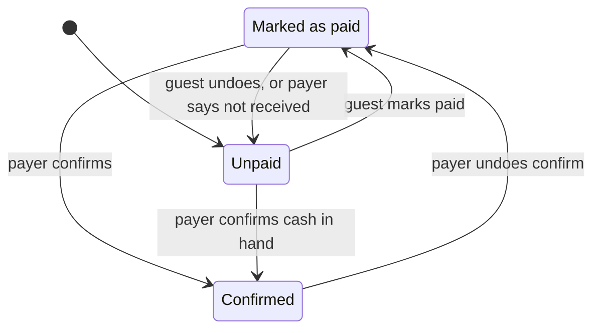

# splIT: Product Requirements

| | |
| --- | --- |
| Status | Draft v0.3, 2 November 2026 (team answers to Q1, Q3, Q4, Q15; wallet link test) |
| Source | [splIT_proposal.md](../splIT_proposal.md) (the submitted proposal) |
| Team | Ralph Abdallah · Charbel Harb · Jason Khadra |
| Course | 020WBPES3 Web Programming · ESIB |

Anything marked **(proposed)** goes beyond the proposal and needs team agreement. Open questions, each with a proposed default so work isn't blocked, are in [§13](#13-open-questions).

---

## 1. Summary

splIT lets a group split a shared receipt in under a minute: one person pays and photographs the bill, everyone else taps what they had, and the app tracks who has paid back. Money moves outside the app (cash, Whish, OMT Pay). splIT records who owes what and whether they have paid.

## 2. Problem

- Working out each share by hand is slow and error-prone: shared dishes, tax, service charge, tips, and receipts printed in both USD and LBP.
- The payer then chases people for weeks, with no record of who has paid.
- Friends won't install an app or create an account to settle one dinner, and they settle with cash or wallet apps, not bank cards.

## 3. Users

### Payer (has an account; also called the admin)
Pays the restaurant for the whole table, usually by card, with everyone's tips added to that payment. Wants to enter the bill fast, share it while everyone is still at the table, know exactly what to charge to the card, and see who still owes without chasing. Claims their own items like everyone else. Uses a phone at the table; may open the dashboard on a laptop later.

### Guest (no account)
Ate at the table. Wants to find what they had, see exactly what they owe, and pay the way they already do, in under a minute. Opens a QR code or link on their phone, often on mobile data. Will not install anything or sign up.

## 4. Goals and success criteria

**Product goals**
- **G1** A guest goes from scanning the QR code to a claimed share and a chosen payment method in under 60 seconds.
- **G2** Every split is exact: all members' totals plus the unclaimed remainder add up to the bill total, to the smallest currency unit.
- **G3** The payer can see at any moment who has paid, who says they paid, and who still owes.
- **G4** Before paying the restaurant, the payer knows the exact card amount: the bill total plus everyone's tips.

**Capstone success criteria**
- The full flow runs live on real phones: payer creates a bill, three guests join by QR, claim items (including a shared one), pay, and the payer confirms.
- All eleven must-haves work end to end.
- The split engine has unit tests covering the rounding edge cases in §8.
- Deployed: front end on Vercel, API on Render.

## 5. Scope

### 5.1 Must-haves (MVP)

| ID | Feature | Summary |
| --- | --- | --- |
| M1 | Payer account | Sign up, log in, log out; set up how they get paid (Whish, OMT, Neo, Suyool) by uploading each wallet's receive-money QR code |
| M2 | Create a bill | From one or more photos of the receipt: the AI reads it, the payer reviews and fixes it. No blank form |
| M3 | Receipt photos | Stored with the bill; one receipt can take several photos |
| M4 | Share | A QR code on the payer's screen, or a link |
| M5 | Guest join | Open the link, type a name, done. The browser remembers them |
| M6 | Claim items | Tap an item to claim one, then + / − to change the count; a shared item is split between everyone who claims it |
| M7 | Extras | Tax and service spread proportionally to each person's items, rounded to the cent |
| M8 | Pay | Guest sees their total (share plus tip) and picks Cash or one of the payer's wallets; a wallet opens the payer's own link from their QR code, and the guest types the amount shown |
| M9 | Payment status | Unpaid → Marked as paid → Confirmed, visible to the payer by name |
| M10 | Payer dashboard | Their bills, who has paid, who still owes |
| M11 | Tips | After claiming, each person is asked "Add a tip?". Tips are tracked apart from the bill, so the payer knows what to add to the card |

M11 was added after the proposal (team decision, 2 November 2026) and replaces the proposal's bill-level tip.

### 5.2 Nice-to-haves (proposed priority order)

| ID | Feature | Why this rank |
| --- | --- | --- |
| N1 | Live updates | Three phones claiming at once is the demo; without it, screens look stale. Polling is the MVP fallback |
| N2 | USD/LBP | Payer sets the exchange rate; everyone sees their share in both currencies. Cheap, and very relevant locally |
| N3 | Receipt scanning | **Moved into M2** (team decision, 3 November 2026): bills are only created from photos |
| N4 | Payment proof | Attach a Whish/OMT transfer screenshot when marking paid |
| N5 | Reminders | Nudge link for anyone unpaid after a set number of days |
| N6 | Saved friends | Turn guest names into a contact list for future bills |

### 5.3 Out of scope
- Moving money: no cards, no payment gateway, no Whish/OMT integration (their online checkout is built for registered merchants, not paying a friend).
- Guest accounts, or more than one payer per bill.
- Native mobile apps.
- Running balances or debt netting across bills between friends.

## 6. User flows

### 6.1 Payer creates and shares a bill
1. Logs in. First time: signs up, then answers "How do you receive money?" and adds each wallet's QR code (M1).
2. Starts a new bill: venue, date (defaults to today), currency (defaults to USD, proposed).
3. Adds items (name, unit price, quantity), then the tax amount and rate and the service charge printed on the receipt.
4. Optionally attaches a photo of the receipt.
5. Opens the share screen: a large QR code, plus Copy link and the phone's native share sheet.
6. Claims their own items, the same way guests do.

### 6.2 Guest joins, claims and pays
1. Scans the QR code or opens the link, and sees the venue, the payer's name and the item list.
2. Types their name and is in. A returning guest skips this and lands on their share.
3. Taps an item to claim one, and uses + and − to change how many (2 of the table's 5 pizzas). Shared items show who else claimed them. Their total, including their share of tax and service, updates with every change.
4. Taps Done. An "Add a tip?" sheet appears. They dismiss it, or add a tip: Ralph's share is $17, he rounds up to $20, so his tip is $3.
5. Opens Pay and picks a method:
   - **A wallet the payer set up (Whish, OMT, Neo, Suyool):** the amount is shown large with a copy button. Open Whish opens the payer's own Whish link, so the app opens on paying the payer. They type the amount and send.
   - **Cash:** they hand it to the payer.
6. Taps Mark as paid.

### 6.3 Payer tracks and confirms
1. The bill shows the card total: the bill total plus all tips. If the bill is $370 and tips add up to $30, the payer charges $400 to their card.
2. The dashboard lists their bills with collected and outstanding amounts.
3. A bill's detail lists every member: name, share, tip, method, status.
4. When money arrives, the payer confirms. If it didn't arrive, they send the member back to Unpaid.

## 7. Functional requirements

### M1 Payer account
- Email and password sign-up, log-in and log-out through Supabase Auth. The session survives a reload.
- Profile: the payer's name.
- The Express API verifies the Supabase access token on every payer request. Missing or invalid token returns 401. A bill that belongs to someone else returns 404, so its existence isn't leaked.

**Get-paid setup** (team decision, 3 November 2026; replaces the wallet phone number)
- Right after sign-up, the payer answers "How do you receive money?" and picks any of Whish, OMT, Neo and Suyool. Cash always works and needs no setup.
- For each wallet picked, splIT shows numbered steps for saving that wallet's receive-money QR code as an image, then asks for the image. Whish: open the Whish app, tap Add, tap Whish Me, tap Share QR, save the image, upload it here. Steps for OMT, Neo and Suyool: to come from the team (Q19).
- splIT reads the QR code in the browser and checks that it holds a web link for that wallet (Whish: `whish.money`; OMT: `omt.com.lb`; Neo and Suyool: Q19). It saves the link, not the image. A picture with no QR code, or a link to another site, gets a clear error and another try.
- The payer can replace or remove a wallet later from their profile. With no wallets set up, guests see Cash only.

**Accept when:** a payer signs up, picks Whish, uploads their Whish Me QR image, and sees their Whish link saved; reloads and is still logged in with the link saved; requests without a token are rejected.

### M2 Create a bill (from photos)
Team decision, 3 November 2026: bills are never typed in from scratch.
1. **Photos:** tapping New bill opens the camera straight away; the payer takes one or more photos of the receipt (up to 6, in order, one per part of a long receipt).
2. **Read:** the AI (OpenAI vision model, called from Express so the key stays secret) reads the photos and returns only what is printed: venue, date, currency, each line as printed (quantity, name, printed amount, and a unit price if one is printed separately), printed subtotal, tax amount and rate, service, total, and the LBP rate if printed. **The AI never calculates.**
3. **The app calculates:** unit price = printed line amount ÷ quantity (or the printed unit price); if the printed amounts only add up when read as unit prices, the app reads them that way. A line that doesn't divide evenly (e.g. $10.00 for 3) is split into lines that add up to the exact cent. Tax with "included" on the receipt is shown, not added (Q15). Tip guides, card slips and table numbers are ignored.
4. **Review:** every field is editable: venue, date, currency, each item (name, quantity, unit price), tax, rate, service. Lines can be removed, and a missed line can be added. A check compares the app's total with the printed total: a match shows in green, a mismatch in amber with both amounts. The payer can still create the bill.
5. **Create:** the bill, its items, its photos and the payer's member row are saved, and the share screen opens (M4).
- If the AI can't read the photos (blurry, not a receipt, service down), the payer is told why and can retake them. There is no blank-form fallback.
- Tips are not a bill field. Each person adds their own (M11).
- Editing a bill after guests have joined: see Q7.

**Accept when:** each receipt in `Receipts/` turns into a bill whose items, quantities, unit prices and total match the paper, after at most a few corrections.

### M3 Receipt photos
- Photos are downscaled on the phone before upload (long side ≤ 1600 px, JPEG).
- Stored in a private Supabase Storage bucket (`receipts`), one row per photo in `bill_photos`; served through short-lived signed URLs.
- Guests can view them, to check the items against the paper (later iteration).

**Accept when:** the photos used to create a bill are stored with it, in order.

### M4 Share
- Each bill gets a random `share_token` (at least 128 bits) used in its link, e.g. `/b/<share_token>`.
- Share screen: a large QR code of the link, a Copy link button, and the native share sheet where the browser supports it.

**Accept when:** scanning the QR code with the stock camera on iOS and Android opens the guest view.

### M5 Guest join
- Opening the link shows the bill summary (venue, date, payer's name, items) before joining.
- Joining takes only a name (1 to 40 characters, trimmed). The server creates a `bill_members` row and returns a random `guest_token` (at least 128 bits).
- The client stores the guest token in `localStorage`, keyed by share token. Reopening the link skips the join step.
- A "Not you?" action lets someone on a shared device join as a new person.
- Duplicate names: see Q8. Lost tokens (new browser): the guest rejoins, and the payer can remove the stale member (Q10).

**Accept when:** a guest joins on a phone, closes the tab, reopens the link, and gets back the same member with the same claims.

### M6 Claim items
- Tapping an item claims one unit of it. A + / − counter then sets how many units that person had; going to zero unclaims it.
- Each item shows how many of its units are claimed ("3 of 5") and by whom.
- While claimed units don't exceed the quantity, each unit costs the unit price and the leftover units are unclaimed.
- When claimed units exceed the quantity, people are sharing: the line total is split in proportion to the units each person claimed. One pizza claimed once each by three people costs a third each. Rules in §8; see Q14.
- The payer claims their own items the same way, through their own member row.
- A guest can only change their own claims (checked against their guest token).
- Claims lock while the member is Marked as paid or Confirmed (proposed; see Q9).

**Accept when:**
- 5 pizzas at $10.00: Ralph claims 1 and Charbel claims 2, so they owe $10.00 and $20.00 before extras, and the other 2 pizzas ($20.00) show as unclaimed.
- 1 item at $30.00 claimed once each by three people costs each $10.00; when one unclaims, the other two pay $15.00 each.

### M7 Extras
- Tax and service are spread in proportion to each member's item subtotal, using the rules in §8. Tips are not extras: each person sets their own (M11).

**Accept when:** on a $100.00 subtotal with $20.00 of extras, a member whose items total $25.00 owes $30.00.

### M8 Pay
- The guest sees the amount to pay (their share plus their tip), a breakdown (items, share of tax and service, tip), and the method choices.
- The guest only sees the wallets the payer set up (M1), plus Cash.
- **Wallet:** the amount is shown large with a copy button, and "Open Whish" is a real link (`<a href>`) to the payer's own link from their QR code, so the wallet app opens on paying the payer. No link can carry the amount (R1), so the guest types it. A guest without the app lands on the wallet's website.
- **Cash:** no extra step.
- The guest's chosen method is saved on their member row.

**Accept when:** on a phone with Whish installed, choosing Whish shows the amount and Open Whish opens the app on paying the payer.

### M9 Payment status
- Each member has one status, following the state machine in §9. The server enforces every transition.
- The payer sees every member's status by name.

**Accept when:** every allowed transition works from the right role, and every other transition is rejected.

### M10 Payer dashboard
- The payer's bills, newest first: venue, date, total, collected, outstanding, and how many members are confirmed.
- Bill detail: the bill total, tips and card total (M11), then each member's name, share, tip, method and status, with the payer's actions (confirm, not received, remove).
- A total of what is still owed across all bills.

**Accept when:** after guests mark paid and the payer confirms, the dashboard numbers reflect it on reload (instantly once N1 is in).

### M11 Tips
Added after the proposal (team decision, 2 November 2026). Replaces the proposal's bill-level tip.
- When a member taps Done after claiming, an "Add a tip?" sheet opens. They dismiss it (no tip) or add one.
- Adding a tip: round up to a total (share $17, pay $20, tip $3) or type a tip amount (proposed; the exact choices come with the design).
- The tip is stored on the member, separate from their share. It is never spread across the table or rounded with the split.
- The member pays share plus tip, and can change the tip until they mark paid.
- The payer's bill shows three numbers: **bill total** (the receipt), **tips** (everyone's tips added up) and **card total** (the two together), which is what the payer charges to their card.
- The payer can add a tip of their own; it counts in the tips total.
- After charging the card, the payer taps **Card paid** (proposed, Q16). That locks tips: the card total stays at what was charged, and the "Add a tip?" sheet stops appearing, because a tip added later would never reach the restaurant.

**Accept when:** shares add up to $370 and tips to $30, and the payer's bill shows bill total $370, tips $30, card total $400.

## 8. Split calculation rules

All split and rounding logic runs on the server. Code works in integer minor units, never floating point (proposed): cents for USD, whole pounds for LBP (see Q6).

**Definitions**
- Line total of item *i*: `L_i = price_i × quantity_i` (price is the unit price)
- Units member *m* claimed of item *i*: `u_im`; all claimed units of item *i*: `c_i = Σ u_im`
- Bill subtotal: `S = Σ L_i`
- Extras: `E = tax + service`, with tax counted as 0 when it's already included in the prices (tips are separate)
- Bill total: `T = S + E`
- Card total: `C = T + Σ tips`

**Steps**
1. **Item shares.** Divide each line by `D_i = max(c_i, quantity_i)`. Member *m* gets `L_i × u_im / D_i`, and the **unclaimed** bucket gets `L_i × (D_i − c_i) / D_i`. So a line with fewer claims than units costs the unit price per unit, with the rest unclaimed; a line with more claims than units (sharing) is split by units claimed.
2. **Member subtotal.** `s_m` = the sum of member *m*'s item shares. The unclaimed bucket's subtotal is `U`.
3. **Extras.** Each member gets `E × s_m / S`, and the unclaimed bucket gets `E × U / S`. If `S = 0`, all extras go to the unclaimed bucket.
4. **Member total.** `t_m = s_m + e_m`. The member pays `t_m + tip_m`.

**Rounding.** Steps 1 and 3 use the largest remainder method: floor every share, then give the leftover units (cents) one each to the largest fractional parts, ties broken by join order (`bill_members.created_at`). This is what keeps the invariant exact.

**Invariant (tested):** `Σ t_m + unclaimed total = T`, exactly. Tips never enter the split, so `C − T = Σ tips`.

**Worked example (USD, in cents).** One pizza at 20.00 (quantity 1), claimed once each by A, B and C; Burger 12.00 claimed by A; Lemonade 4.00 unclaimed; service 3.60. So `S = 3600`, `E = 360`, `T = 3960`. A joined first, then B, then C.

| | Pizza share | Items | Extras (exact → rounded) | Total |
| --- | --- | --- | --- | --- |
| A | 667 | 1867 | 186.7 → 187 | **20.54** |
| B | 667 | 667 | 66.7 → 67 | **7.34** |
| C | 666 | 666 | 66.6 → 66 | **7.32** |
| Unclaimed | | 400 | 40.0 → 40 | **4.40** |
| **Sum** | 2000 | 3600 | 360 | **39.60** ✓ |

The pizza's 2000 cents ÷ 3 leaves 2 cents over, which go to A and B. The extras floor to 358, leaving 2 cents for the two largest fractions (A and B, tied at .7).

**Units example.** 5 pizzas at 10.00, so `L = 5000`. Ralph claims 1 and Charbel claims 2: `c = 3`, `D = 5`, so Ralph 10.00, Charbel 20.00, unclaimed 20.00. Then four more people claim 1 each: `c = 7`, `D = 7`, and each claimed unit is worth 5000 / 7 ≈ 714.29 cents. After rounding (join order: Ralph, Charbel, then the others), Ralph pays 7.15, Charbel 14.29, and the four others 7.14 each: 50.00 exactly, nothing unclaimed.

## 9. Payment status

| From | To | Who | Notes |
| --- | --- | --- | --- |
| Unpaid | Marked as paid | Guest | Requires a chosen method. Snapshots the amount (proposed, see Q7) |
| Marked as paid | Unpaid | Guest | Undo, before the payer confirms |
| Marked as paid | Unpaid | Payer | Not received |
| Marked as paid | Confirmed | Payer | Sets `confirmed_at` |
| Unpaid | Confirmed | Payer | Cash handed over in person (proposed) |
| Confirmed | Marked as paid | Payer | Undo a mistaken confirm (proposed) |

Any other transition is rejected with 409. Status is never conveyed by color alone. The payer's own member row starts as Confirmed and never shows as owing.

## 10. Data model

The five tables in the proposal stay, with the changes below: `users` (payers only), `bills`, `items`, `bill_members` (guests, plus the payer), `item_claims` (many-to-many between items and members). See the ER diagram in [splIT_proposal.md §4](../splIT_proposal.md).

**Decided changes** (2 November 2026)
- `bills.tip` is dropped. `bill_members.tip` (numeric ≥ 0, default 0) replaces it (M11).
- `bills.tax_rate` (numeric, nullable): the rate printed on the receipt, for display only.
- `bills.tax_included` (boolean, default false): when true, the tax is shown but not added (Q15).
- `users.wallet_phone` is dropped. A new table, `payout_methods` (`id`, `user_id` → `users.id`, `wallet` whish | omt | neo | suyool, `pay_url`, `created_at`; unique per user and wallet), holds the links read from the payer's QR codes (M1).
- `item_claims.units` (int, not null, default 1, ≥ 1) (M6).
- `bill_members.is_payer` (boolean, default false), with exactly one payer row per bill (partial unique index). The payer row has no `guest_token`, so that column is nullable for payer rows only.

**Proposed additions**
- `created_at timestamptz default now()` on every table. Join order drives the rounding tie-break, and the dashboard sorts by it.
- Constraints: unique `share_token` and `guest_token`; primary key `(item_id, member_id)` on `item_claims` (a double tap can't double-claim); `ON DELETE CASCADE` from `bills` downward; `CHECK` constraints on `currency`, `method` and `status` values, money ≥ 0, quantity ≥ 1.
- `bill_members.method` is nullable until the guest picks one.
- `bill_members.marked_paid_at` and `bill_members.paid_amount` (share plus tip when they marked paid), so the dashboard can flag a total that changed afterwards (Q7).
- `bills.card_paid_at` (timestamptz, nullable): set when the payer taps Card paid, which locks tips (Q16).

**Access model**
- **Payer requests:** the Supabase access token identifies `users.id`; the bill must belong to that user.
- **Guest requests:** the share token in the path picks the bill; the `X-Guest-Token` header picks the member.
- The browser never queries Postgres. Express is the only path to data; the client uses Supabase only for authentication.

## 11. Non-functional requirements

**Mobile first.** Designed for 360 to 430 px wide screens first. Targets the current and previous major versions of iOS Safari and Android Chrome. The payer dashboard also works on desktop.

**Speed.** Every tap gives instant feedback: claims update optimistically, then reconcile with the server's answer. The guest page should be usable within about 2 seconds on a mid-range Android phone on 4G (target). Keep the guest bundle small.

**Security and privacy**
- Share and guest tokens come from a cryptographic random source, at least 128 bits.
- The payer's wallet links are shown only to guests who have joined that bill, and only links on that wallet's own domain are accepted.
- All input validated on the server; join and claim endpoints rate-limited.
- Receipts and proof screenshots in private storage, served through short-lived signed URLs.
- Secrets live only in server environment variables. The OpenAI key never reaches the browser.
- **AI spend is capped** (added 3 November 2026): every receipt read that reaches OpenAI is recorded with its tokens (`ai_usage`). A payer gets at most 10 reads an hour, 30 a day and 150,000 tokens a day; all payers together get 2,000,000 tokens a day, the backstop against many sign-ups. One read at a time per payer. Limits are checked before photos are accepted, and the payer is told when they can try again. Failed reads count, since they still cost. All limits can be changed in `backend/.env`. A monthly budget cap should also be set in the OpenAI dashboard.
- HTTPS everywhere (the clipboard API requires it).

**Accessibility.** WCAG 2.2 AA. Touch targets at least 44 × 44 px. The core guest flow works with VoiceOver and TalkBack. Honors `prefers-reduced-motion` and `prefers-reduced-transparency`.

**Reliability.** Guest actions are idempotent. A network error shows a retry and never loses what the user entered.

**Formatting.** English UI. USD shows two decimals; LBP shows whole pounds with thousands separators.

## 12. Risks

| ID | Risk | Impact | Mitigation |
| --- | --- | --- | --- |
| R1 | **Confirmed:** no wallet can be opened with the amount filled in. Phone tests (2 Nov 2026): `whish.money/app/pay/<code>` opens the Whish app, but `<code>` is a Whish Pay invoice that holds the amount and recipient, and only registered merchants can create one through Whish's business API; a made-up code points to no invoice. The OMT links didn't open OMT | Guests type the amount themselves | The payer uploads each wallet's receive-money QR code; its link opens the app on paying the payer, and the amount is shown large with a copy button (M1, M8) |
| R2 | Clipboard writes need HTTPS and a user gesture, and iOS is strict | Copy fails silently | Call the copy directly inside the tap handler; show a visible "Copied" state; selectable text as a fallback |
| R3 | A guest clears their browser or switches browsers | They lose their identity and rejoin as a duplicate | "Not you?" flow; the payer can remove stale members |
| R4 | Render's free tier spins the API down when idle | The first request can take tens of seconds, e.g. at the start of the demo | Wake the API before demoing; show a clear loading state |
| R5 | Concurrent claims from several phones | Stale totals on screen | The server is the source of truth; polling for MVP, Socket.io with N1 |
| R6 | AI receipt scanning misreads items (N3) | Wrong amounts | Mandatory review screen; manual entry is always available |

## 13. Open questions

| ID | Question | Proposed default |
| --- | --- | --- |
| Q1 | Is an item's `price` the unit price or the line total? | **Resolved:** unit price. People claim units with a + / − counter (M6) |
| Q2 | With quantity above 1, can someone claim single units? | **Resolved:** yes, see Q1 |
| Q3 | Are tax, service and tip entered as amounts or percentages? | **Resolved:** the tax amount and rate come off the receipt; tips are per person and tracked apart from the bill (M11). Service: the amount printed on the receipt (proposed) |
| Q4 | Does the payer claim their own items? | **Resolved:** yes. The payer gets a member row with the bill (`is_payer`, status Confirmed) |
| Q5 | Who covers unclaimed items? | Nobody automatically. The payer sees "Unclaimed: $X" and can chase or absorb it |
| Q6 | What is the rounding unit for LBP bills? | Whole pounds in calculations. Decide with the team whether payments should round to the nearest 1,000 LBP |
| Q7 | Can the payer edit items after guests have claimed or paid? | Yes. If a Marked-as-paid or Confirmed member's total changes, the dashboard flags the difference against `paid_amount` |
| Q8 | Two guests with the same name on one bill? | Block exact duplicates (case-insensitive) and suggest adding an initial |
| Q9 | Can a guest change claims after marking paid? | No: they undo Marked as paid first. Claims stay locked once Confirmed |
| Q10 | Can the payer remove a member? | Yes, unless they are Confirmed. Their claims are removed with them |
| Q11 | Does a bill have a closed or settled state? | Derived, not stored: settled when every member is Confirmed and nothing is unclaimed |
| Q12 | English only, or Arabic too? | English only for the MVP |
| Q13 | What are the capstone deadline and milestone dates? | Unknown. Record them in PLAN.md |
| Q14 | When more units are claimed than exist (three people each claim the one pizza), is splitting in proportion to units claimed right? | Yes, as written in §8. When everyone claims one, it's an even split |
| Q15 | If the receipt says tax is already included in the prices, does splIT add it? | **Resolved:** no. A "Tax included in prices" switch shows the tax for reference without adding it again |
| Q16 | Tips go on the payer's card, so a tip added after the card is charged never reaches the restaurant. Example: the card is charged $400 at the table; two days later Jason opens the link, claims his items and adds a $5 tip. Should the app still ask him to tip? | No. The payer taps **Card paid** after charging the card. That locks tips: the card total stays at what was charged, and later guests aren't asked to tip |
| Q17 | Opening `whish.money/app/pay/<made-up code>` launches Whish. Does it land cleanly? | **Superseded** by Q18: guests open the payer's own link instead |
| Q18 | Can the payer upload their wallet's receive-money QR code so splIT reads the link inside? | **Resolved:** yes, this is the get-paid setup in M1. Still to check with a real Whish Me QR that it holds a `whish.money` link |
| Q20 | What if the app's total doesn't match the printed total after reading? | **Resolved:** the AI only reads; the app calculates and shows the difference in amber; the payer fixes or accepts it and can still create the bill |
| Q19 | What are the steps to save the receive-money QR in OMT, Neo and Suyool, and which domains do their links use? | Team will send the steps. Until then, generic steps, and Neo/Suyool links are accepted from any https address and shown to the payer to confirm |
