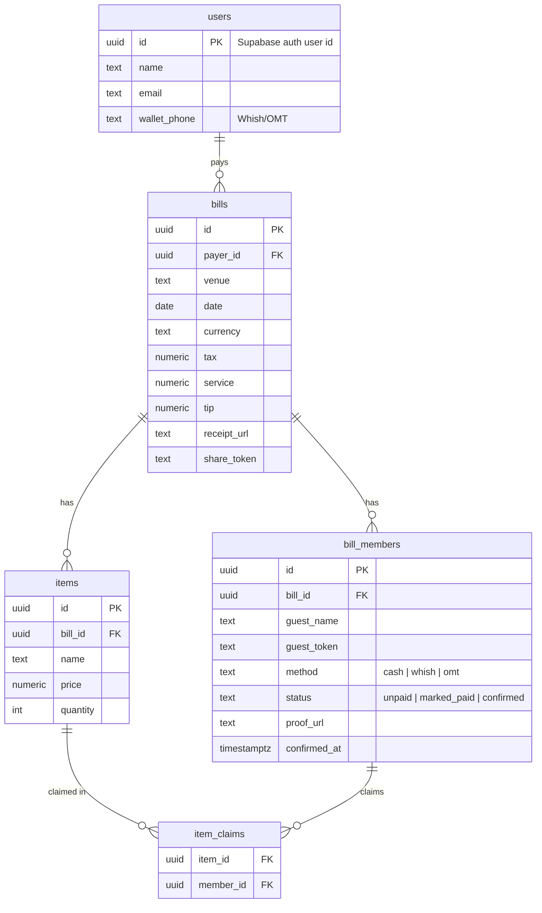

# splIT — Capstone Project Proposal

**Course:** 020WBPES3 Web Programming · ESIB
**Team:** Ralph Abdallah · Charbel Harb · Jason Khadra
**Date:** 2 November 2026

---

## 1. The idea

splIT lets a group split a shared receipt in under a minute: one person pays and photographs the bill, everyone else taps what they had, and the app tracks who has paid back.

**The problem.** After a dinner or outing, one person usually pays the whole bill. Working out each share is slow and error-prone, especially with shared dishes, service charge, tips and receipts printed in both USD and LBP. Then the payer has to chase people for weeks.

**Who it's for.** Groups of friends, students and coworkers in Lebanon who eat out together and settle up with cash or wallet apps like Whish and OMT Pay rather than bank cards.

**How it works.** Only the payer needs an account. They sign in, upload the receipt, which becomes a list of items, and show a QR code or send a link. Friends scan it, type their name with no sign-up, and tap the items they had. Shared items are split evenly between the people who claim them, and tax, service and tip are spread proportionally. Each friend picks cash, Whish or OMT Pay; a wallet choice opens that app with the payer's number and their amount ready to send. They mark their share as paid, and the payer confirms receipt.

---

## 2. Feature list

The app records who owes what and tracks repayment; money moves outside the app (cash, Whish or OMT transfer), so no bank card or payment gateway is needed.

### Must-haves

1. **Payer account:** sign up, log in, log out, and save the Whish/OMT phone number to be paid on. Nobody else needs an account.
2. **Create a bill:** venue, date, currency, and line items (name, price, quantity) entered manually.
3. **Receipt photo:** upload it and attach it to the bill.
4. **Share:** a QR code on the payer's screen, or a link.
5. **Guest join:** a friend opens the QR or link, types their name, and is in. The browser remembers them, so reopening the link brings back their share.
6. **Claim items:** a shared item is split evenly between everyone who claims it.
7. **Extras:** tax, service charge and tip spread proportionally to each person's items, rounded to the cent.
8. **Pay:** each guest sees their total and picks cash, Whish or OMT Pay. A wallet choice copies the payer's number and the amount, then opens that app.
9. **Payment status** per person, visible to the payer by name: Unpaid → Marked as paid → Confirmed.
10. **Payer dashboard:** their bills, who has paid, and who still owes.

### Nice-to-haves

- **Receipt scanning:** AI turns the photo into line items, which the payer reviews and corrects.
- **USD/LBP:** the payer sets the exchange rate and each person sees their share in both currencies.
- **Live updates:** claims and payments appear on everyone's screen without refreshing.
- **Payment proof:** attach a screenshot of the Whish/OMT transfer when marking a share as paid.
- **Saved friends:** the payer can turn guest names into a contact list for future bills.
- **Reminders:** the payer sends a nudge link to anyone who hasn't paid after a set number of days.

---

## 3. Tech stack

A React front end talks to our own Node.js/Express REST API, which stores data in PostgreSQL.

| Layer | Choice | Notes |
| --- | --- | --- |
| Front end | React (Vite) + plain CSS | Mobile-first, since people open the link on their phones at the table |
| Back end | Node.js + Express REST API | All split and rounding logic runs server-side |
| Database | PostgreSQL (hosted on Supabase) | Relational data: bills, items, claims, payments |
| Authentication | Supabase Auth, payer only: email + password sign-in; the Express API verifies the Supabase session token on every request | Guests have no account: the bill's random link token lets them in, and a guest token saved in their browser remembers who they are |
| File storage | Supabase Storage | Receipt photos and payment screenshots |
| Third-party API | OpenAI API (vision model) for receipt scanning, nice-to-have | Called from the Express API so the key stays secret; returns items, tax and total as JSON for the payer to review. Manual entry always works as a fallback |
| Libraries | `qrcode` (share QR codes), Socket.io (live updates, nice-to-have) | |
| Hosting | Vercel (front end), Render (API) | |

We deliberately don't integrate Whish or OMT Pay: their online checkout is built for registered merchants, not for paying a friend. A production version could add it later.

---

## 4. Database schema

Five tables. Only the payer is a `users` row. Each friend is a `bill_members` row with just a name and a guest token, holding how they paid and whether the payer confirmed it. `item_claims` records who had which item, so a shared item's price is divided by its number of claims.

| Table | Columns | Relationships |
| --- | --- | --- |
| `users` (payers only) | `id` (= Supabase auth user id), `name`, `email`, `wallet_phone` (Whish/OMT) | one user pays many `bills` |
| `bills` | `id`, `payer_id`, `venue`, `date`, `currency`, `tax`, `service`, `tip`, `receipt_url`, `share_token` | `payer_id` → `users.id`; one bill has many `items` and many `bill_members` |
| `items` | `id`, `bill_id`, `name`, `price`, `quantity` | `bill_id` → `bills.id` |
| `bill_members` (guests, no account) | `id`, `bill_id`, `guest_name`, `guest_token`, `method` (cash / Whish / OMT), `status`, `proof_url`, `confirmed_at` | `bill_id` → `bills.id` |
| `item_claims` | `item_id`, `member_id` | `item_id` → `items.id`; `member_id` → `bill_members.id` (many-to-many between items and members) |

